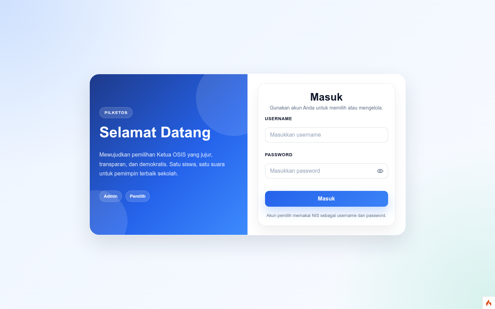
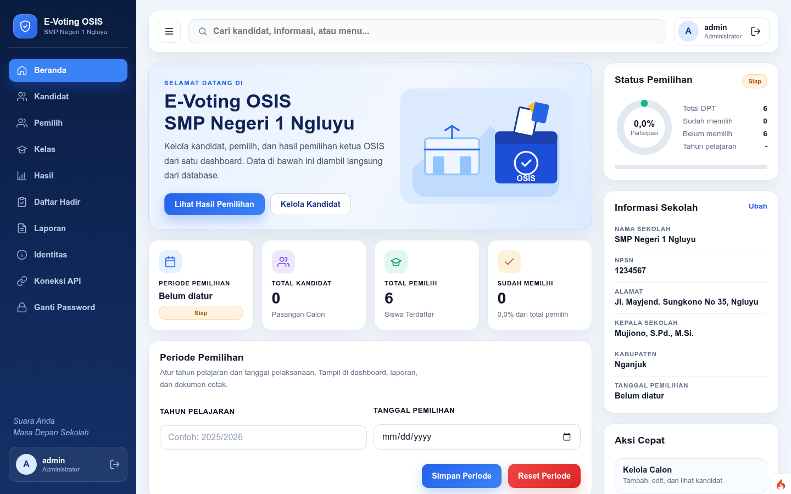
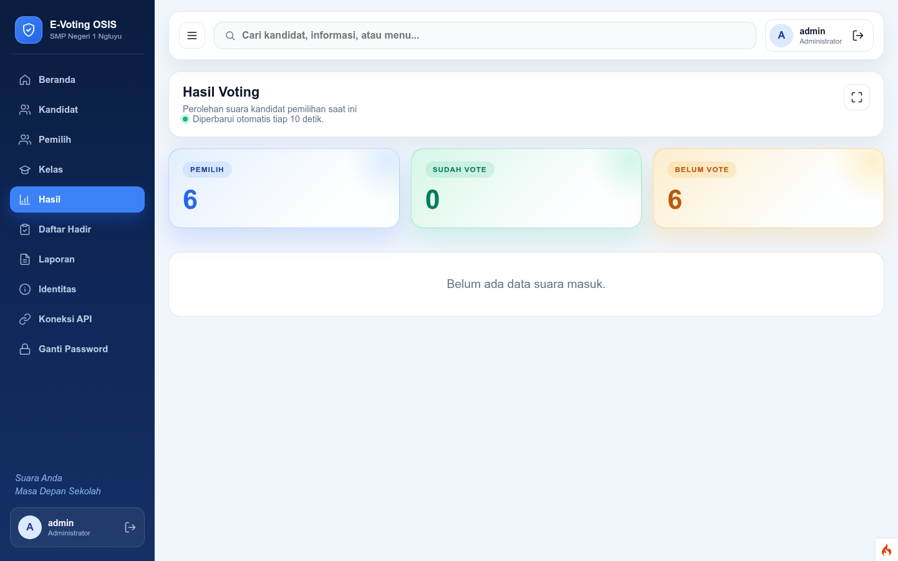
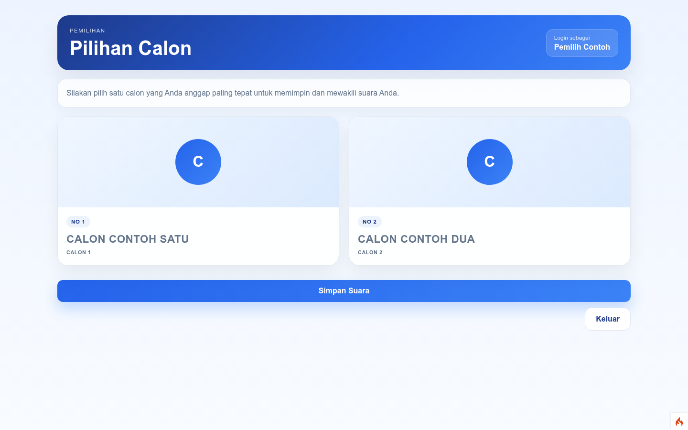
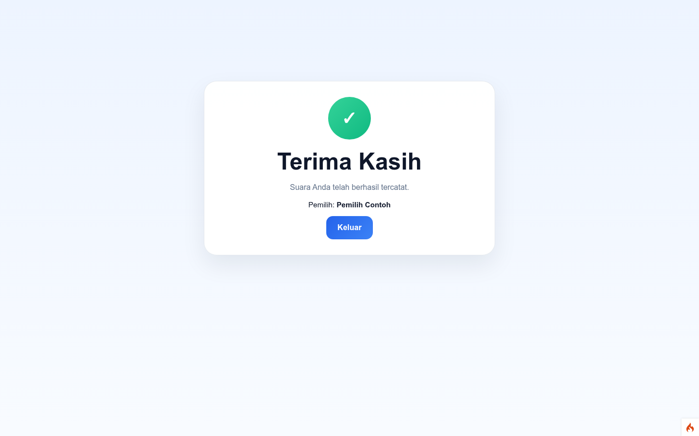

# Pilketos v2 — E-Voting Ketua OSIS

Aplikasi pemilihan Ketua OSIS berbasis web (CodeIgniter 4) untuk sekolah.
Ini adalah rewrite mandiri dari aplikasi legacy CodeIgniter 3 ("Pilketos").

## Fitur utama

- Satu pintu login — admin otomatis ke dashboard, pemilih otomatis ke bilik suara
- Dashboard admin: statistik, periode pemilihan, kandidat, reset data/pemilih
- Data master: identitas sekolah, kelas (default 7A–9D), siswa/DPT, kandidat + foto
- Sinkronisasi DPT dari web sekolah (API) + impor CSV + tambah manual
- Voting satu-pemilih-satu-suara (UNIQUE + guard back/double-submit)
- Hasil voting live (auto-refresh), mode presentasi fullscreen
- Laporan + daftar hadir + export PDF tabel
- Keamanan: CSRF global, hapus via POST, regenerate session, validasi NIS

## Akun demo

- Admin: `admin` / `admin`
- Pemilih: gunakan NIS sebagai username dan password (contoh: `9999` / `9999`)

## Tangkapan layar

## Instalasi

Lihat [docs/INSTALL.md](docs/INSTALL.md).

## Alur operasional pemilihan

1. Sinkronkan/impor DPT (siswa + guru) → 2. Atur tapel & tanggal → 3. Voting →
   4. Pantau hasil + cetak laporan → 5. Reset untuk siklus berikutnya.

## Pengembangan

- Roadmap: [ROADMAP.md](ROADMAP.md)
- Test: `composer test` (atau via container, lihat INSTALL)
- Docker internal: `docker/` + `docker-compose.yml` di direktori ini
